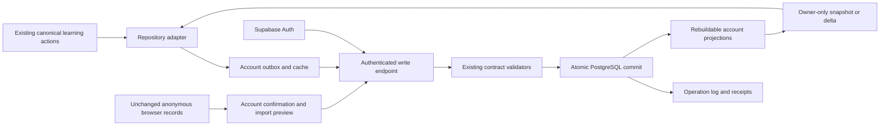

# SIASET Learn — Phase DB-1: Supabase architecture and migration plan

4 November 2026 · Planning only · Prepared for project owner and scientific reviewer

**Decision already made:** support BOTH email/password and Google OAuth. **This document does not authorize DB-2 implementation or provisioning.** No Supabase project/database was inspected or created. No application source, dependencies, scientific engines, Git state, migrations or deployment were changed. The only deliverable is this report.

## 1. Evidence labels and recommendation

**V** means verified in local source or read-only module evaluation during DB-1. **D** means checked in current official documentation on 4 November 2026. **P** means proposed architecture or future acceptance requirement, not implemented behavior. **A** means a pending decision or approval. Sections describing future components, tables, endpoints and flows are P unless explicitly labeled otherwise.

P: retain the React/Vite application and its canonical learning callbacks. Introduce Supabase Auth for identity, PostgreSQL for durable account data, an account-scoped local outbox/cache for offline work, and a trusted write endpoint that validates existing contracts before one atomic database transaction. Keep anonymous browser learning available. Sign-in alone must never upload or claim existing browser progress. Migration needs a separate, explicit confirmation naming the authenticated account and a verified server receipt.

P: use a server-ordered operation log plus rebuildable projections. Preserve the existing local clock/ID replay for legacy data; do not pretend its shared-browser ordering already solves concurrent devices. Proposed account ordering uses server revisions, field conflict checks and reset generations. Those are deliberate sync policy additions requiring acceptance.

## 2. Local sources and verified baseline

Paths below are relative to this report's directory; links point to inspected files. Historical reports are evidence of history, not proof of current execution.

| Source | What it establishes |
|---|---|
| [progressRepository.js](frontend/src/features/transposable-elements/progressRepository.js) | Operation validation, deterministic replay, pending memory, legacy reads, stable retries, subscriptions |
| [learnerRecords.js](frontend/src/features/transposable-elements/learnerRecords.js) | Lab replay validation, attempt validation, topic completion and denominator |
| [lessonProgress.js](frontend/src/features/transposable-elements/lessonProgress.js) | Index/answer domains, current-answer semantics, legacy parser, completion |
| [useProgress.js](frontend/src/features/transposable-elements/useProgress.js), [PersistenceStatus.jsx](frontend/src/features/transposable-elements/PersistenceStatus.jsx) | Cached external-store subscription and honest browser persistence notices |
| [Laboratory.jsx](frontend/src/features/transposable-elements/Laboratory.jsx), [learning.js](frontend/src/features/transposable-elements/learning.js), [guidedStages.js](frontend/src/features/transposable-elements/guidedStages.js) | Explicit review action, prediction and TnpR gates, numeric stage order, undo/redo/reset |
| [assessment.js](frontend/src/features/transposable-elements/assessment.js), [Assessment.jsx](frontend/src/features/transposable-elements/Assessment.jsx), [assessment-v1.json](frontend/src/features/transposable-elements/tests/assessment-v1.json) | Generated frozen bank, answer validation, scoring and explicit full submission |
| [Lessons.jsx](frontend/src/features/transposable-elements/Lessons.jsx), [LessonActivities.jsx](frontend/src/features/transposable-elements/components/LessonActivities.jsx), [ConsequenceExplorer.jsx](frontend/src/features/transposable-elements/ConsequenceExplorer.jsx), [BacterialExplorer.jsx](frontend/src/features/transposable-elements/BacterialExplorer.jsx) | Eligible inspection/prediction callbacks; optional practice is distinct |
| [topics.json](frontend/src/features/transposable-elements/curriculum/topics.json), [lessons.js](frontend/src/features/transposable-elements/curriculum/lessons.js), [navigation.js](frontend/src/features/transposable-elements/curriculum/navigation.js), [main.jsx](frontend/src/main.jsx), [experimentRouting.js](frontend/src/features/transposable-elements/experimentRouting.js) | Exact identities, routes and navigation |
| [progressReliability.test.js](frontend/src/features/transposable-elements/tests/progressReliability.test.js), [progress-reading.test.js](frontend/src/features/transposable-elements/tests/progress-reading.test.js), [architecture.test.js](frontend/src/features/transposable-elements/tests/architecture.test.js), [phase7.test.js](frontend/src/features/transposable-elements/tests/phase7.test.js) | Storage, retry, sync, lab, assessment and full fixture contracts |
| [storage-audit.json](verification/phase5-release/storage-audit.json), [storage-audit.mjs](verification/phase5-release/storage-audit.mjs) | Historical in-memory growth samples; explicitly not browser quota/latency guarantees |
| [Phase 8A architecture](PHASE8A_FULL_CURRICULUM_INTERACTIVE_REDESIGN_ARCHITECTURE_PLAN.md) | Protected evidence inventory, optional practice boundary, scientific/accessibility approvals still pending |
| [frontend package](frontend/package.json), [root package](package.json), [Vercel configuration](frontend/vercel.json) | React 19/Vite SPA, no Supabase dependency currently, SPA route fallback |

### 2.1 Existing storage and sync behavior — V

- Legacy keys: `siaset-lessons-v1`, `siaset-guided-labs-v1`, `siaset-assessments-v1`. New operations each own `siaset-progress-op-v1:<id>`. Repository reads legacy values without rewriting them.
- Operation envelope: `version:1`, nonempty string `id`, positive safe-integer `clock`, and one of `lesson`, `resetLesson`, `lab`, `attempt`, `resetAttempts`. Production IDs use `crypto.randomUUID`, falling back to 16 random bytes encoded as 32 hex characters. Old IDs therefore must not be constrained to PostgreSQL UUID syntax.
- Replay starts from validated legacy base, deduplicates known/pending operations by ID, sorts by logical clock then lexicographic ID. Inspections union indices, answers replace current answers, a reset deletes at its replay position, later work can recreate partial progress. Labs replace the current record per scenario; attempts append independently; attempt reset clears the list without touching labs/lessons.
- Same-tab subscribers, `storage` events, focus and online events update/retry browser storage. These are local synchronization mechanisms; there is no remote sync, account identity or durable cloud queue.
- Read failure prevents writes to avoid overwriting unseen work. Write failure retains pending operations in process memory. Reload cannot recover memory-only changes. Snapshot status is `saved`, `temporary` or `read-failed`, plus `damaged`; `saved` currently means browser storage only.
- Invalid/future data is ignored for projection and left untouched. The damaged flag detects malformed envelopes and invalid operations; parsers may filter invalid nested legacy fields without exhaustive diagnostics. A migration scanner must report those omissions explicitly.

### 2.2 Completion and scientific boundary — V and protected requirements

V: thirteen lessons contribute 55 zero-based views/contexts; two lab topics give a total denominator of 15. A lesson requires every original index plus correct current `exercise`, `check`, and `check2` where present. Wrong subsequent required answers can revoke derived completion. Inspected indices persist until lesson reset. Seven ordinary view lessons award inspection on the original view action; six context lessons award indices after correct predictions in their explorer callbacks. A raw `inspect` operation records only the index: it cannot prove a prediction interaction occurred.

V: Tn5 final review is stage 4, one replay-valid event, correct `tn5` answer 0, final phase `inserted`. Tn3 final review is stage 5, two replay-valid events, correct `tn3` answer 1 and `resolution` answer 2, final phase `resolved`. Actual replay validation is authoritative, not event count alone. Tn3 resolution has a distinct TnpR availability gate; explanatory stages do not introduce calculated molecular transitions. Preserve the exact stage order, checkpoint text/options, event schemas and replay/tamper checks.

V: only “Record completed guided review” persists lab completion. Reaching final state, following links, sandbox activity, animation, undo/redo or replay does not substitute for this action. The laboratory Reset button resets the running experiment; it does not revoke an already recorded review. There is currently no `resetLab` repository operation. Do not introduce one implicitly.

V: assessment bank version 1 contains exactly 25 full objects. All answers must be valid and all 25 answered before persistence. Score is one point per correct answer; no negative marking. Dates must parse; client dates do not establish causal order. Attempts, score and topic completion are separate. Preserve wording, options/order, correct indices, explanations, references and object/array content. Do not regenerate questions from modified curriculum or put new optional-practice items into bank inputs.

V: read-only import comparison found `JSON.stringify(questions) === JSON.stringify(fixture)` true. SHA-256 of UTF-8 `JSON.stringify(questions)` is `0ed78b64ffba93186cd5c73db7070fcda4e8fccff2e0f4d5d73845b8318cb82f`. This is a semantic serialization fingerprint, not the raw fixture file hash. Appendix A pins every route and view label/index; Appendix B pins question IDs.

P: persist evidence, never a client-supplied `completed:true`, percentage, score or qualification. Derive display from canonical functions and server projections with parity tests. Cloud storage does not make this an instructor-certified assessment: answer keys are already shipped to browsers, legacy evidence is client-originated, and UI interaction cannot be proven retrospectively. Do not strengthen historic eligibility silently.

P: freeze all engine modules under `engine/`, worked examples, model versions, coordinates, copy/lineage IDs, replay, sandbox and scientific limitations. The trusted validator should package the existing pure engine/validation modules without rewriting biology. Snapshot fingerprint parity is a DB-2 gate. Phase 8A optional missions, Topic 03 workbench drafts, camera state and proposed 3D visuals remain outside persisted canonical progress.

## 3. Current Supabase documentation checks — D

Official sources were checked through the Supabase documentation search tool and live documentation pages. The requested lightweight changelog `.md` could not be fetched by the web reader (unsupported content type), and shell fetching hit DNS failure. The HTML [changelog](https://supabase.com/changelog) was read instead, relevant breaking-change entries followed, and topic docs consulted. No claim of exhaustive changelog review or a tested Supabase installation is made.

| Checked guidance | Consequence for this proposal |
|---|---|
| [Explicit Data API exposure change](https://supabase.com/changelog/45329-breaking-change-tables-not-exposed-to-data-and-graphql-api-automatically) | New public tables require explicit grants; the notice gives 30 October 2026 for rollout to existing projects. Plan explicit grants and RLS together, including server-role grants. |
| [API keys](https://supabase.com/docs/guides/getting-started/api-keys) | Browser gets publishable key; server secret keys bypass RLS. Docs announce legacy key deprecation by end of 2026. Use current key types and verify again in DB-2. |
| [Password auth](https://supabase.com/docs/guides/auth/passwords) | Use supported signup/password/recovery APIs; retain email confirmation; explicitly choose flow configuration. |
| [Google sign-in](https://supabase.com/docs/guides/auth/social-sign-in/auth-google) | Configure Web OAuth client, origins and Supabase callback; provider secret stays off the browser. |
| [Redirect URLs](https://supabase.com/docs/guides/auth/redirect-urls) | Site URL and redirect allowlist must be set deliberately; use exact production destinations. |
| [PKCE](https://supabase.com/docs/guides/auth/sessions/pkce-flow) | Code exchange requires browser-stored verifier. Overlapping flows can overwrite it; experimental overlap support is not a dependency of this plan. |
| [Identity linking](https://supabase.com/docs/guides/auth/auth-identity-linking) | Auth can link same-email identities; manual linking is beta. Test provider combinations; never implement application email-based row merging. |
| [RLS](https://supabase.com/docs/guides/database/postgres/row-level-security), [database functions](https://supabase.com/docs/guides/database/functions) | Row ownership, explicit grants and function execution restrictions are separate controls; prefer invoker functions. |
| [Custom SMTP](https://supabase.com/docs/guides/auth/auth-smtp), [Free email-template change](https://supabase.com/changelog/46599-changes-to-email-template-customisation-on-free-tier) | Default mail is unsuitable for student rollout; configure custom SMTP, sender domain and delivery tests. |
| [Backups](https://supabase.com/docs/guides/platform/backups), [pricing](https://supabase.com/pricing) | Select retention/recovery capability and budget before production; local copies are not an operational backup policy. |

## 4. System boundaries and data flow — P



1. Browser keeps existing lesson/lab/assessment callbacks and synchronous optimistic learning feedback. Anonymous mode continues using the existing repository unchanged.
2. Account mode uses a separate repository instance and namespaces keyed by immutable Auth UUID. Persist operation and stable ID in an IndexedDB transaction before describing it as saved on this device. This local cache is necessary for offline use even though account data lives in PostgreSQL. Do not claim a database eliminates browser-storage failures.
3. A future Supabase Edge Function receives the user access token and a bounded request. Explicitly validate with Auth `getUser(token)` before using a privileged database client. Do not assume a publishable key or decoded JWT alone authenticates a user; do not rely solely on platform JWT gateway defaults for the selected key/signing setup. Return 401 on invalid identity. Disable caching of private responses.
4. Server derives owner from verified Auth user, ignores/rejects client owner claims, validates version/content, replays lab evidence and recomputes scores using frozen modules. Then call a service-only transactional database RPC with the derived owner. No remote calls inside the database lock.
5. Transaction writes log, projections, reset generations, sequence and receipt together. Cloud-save acknowledgment requires committed receipt, not HTTP dispatch or a browser write. Readback verifies projection. Browser reconciles canonical state and pending overlay, then acknowledges the matching queued ID.
6. Read initial state through an owner-scoped snapshot endpoint with a consistent cursor; delta endpoint returns ordered records through a fixed high-water cursor. A single transactional snapshot RPC called by the trusted endpoint avoids inconsistent multi-table reads. Direct owner-only table SELECT may support inspection but is not a multi-table consistency protocol.
7. Poll on sign-in, focus, reconnect and periodic foreground activity with backoff. Realtime can later be an invalidation hint after measured need; always fetch authoritative deltas, tolerate duplicate/missed hints. No Realtime dependency or storage bucket is required initially.

P: proposed browser configuration names are `VITE_SUPABASE_URL` and `VITE_SUPABASE_PUBLISHABLE_KEY`. All Vite public variables ship to users. Store Google secret, SMTP credentials and database/server secret only in managed server/provider settings; never put them in reports, source, browser env, logs or local exports. Static curriculum remains bundled; do not make navigation or scientific calculation wait for a database fetch. This is a SPA proposal, not a Next.js/SSR conversion.

## 5. Identity and authentication — P

### 5.1 Stable identity

Use `auth.users.id` UUID as owner everywhere. Supabase manages passwords and provider identities in its Auth schemas; application code never stores password hashes or Google tokens. Email and optional display name are presentation/account recovery data, not primary keys or authorization. Avoid duplicating email in learning tables. Maintain only minimal profile preferences; no class, teacher role, roster or institution access is assumed.

Supabase automatic same-email linking may produce one UUID for email/password and Google. Test verified/unconfirmed combinations and resulting identity list in staging. If two distinct UUIDs exist, keep them separate; do not merge by email, name or client metadata. Manual provider linking can be a separately approved account-settings feature with fresh authentication, cancellation recovery and last-sign-in-method protection; beta behavior is not required for first rollout. A Google-only user can add a password through an authenticated supported Auth flow, with recovery/verification safeguards and explicit messaging. Account linking and browser-progress claiming are separate consent events.

### 5.2 Email/password

Signup calls `signUp` with email/password and the approved confirmation destination. Keep hosted email confirmation enabled; show “check your email” when no session exists and continue anonymous learning. Login uses `signInWithPassword`; no background account creation on failed login. Use generic failure text where appropriate to avoid account enumeration. Never queue passwords or auth requests in the progress outbox.

Password recovery uses `resetPasswordForEmail` to an approved recovery route, validates the returned recovery session, then calls `updateUser` for the password. Expired, reused, cancelled or wrong-origin links show a retry path; they must not alter progress or trigger import. For proposed PKCE email links, document the same-browser requirement and allow restarting the flow; do not promise links opened on another device will succeed. Email change and provider change never reassign owner UUID.

### 5.3 Google

Use redirect-based `signInWithOAuth({provider:'google', options:{redirectTo:...}})` with explicitly configured PKCE on the SPA client. The new callback route exchanges the code once through the SDK, guards duplicate React StrictMode effects, removes sensitive callback parameters from browser history and restores only a validated relative app destination. Do not combine automatic and manual exchange handlers. Serialize auth flow initiation across tabs using an auth-flow coordinator; if a stale verifier remains or an overlapping flow escapes that coordination, show a restart action rather than relying on experimental overlap APIs. Google cancellation leaves anonymous progress intact. Request only identity scopes; no Drive/Calendar or offline Google access is needed.

### 5.4 Domains and redirects

No production domain or Supabase project reference is verified in local configuration. Values below are placeholders to replace after owner approval; do not register guessed domains.

| Location | Future configuration |
|---|---|
| Supabase Site URL | `https://<approved-production-host>` |
| Supabase allowed redirects | Exact production `/auth/callback`, `/auth/recovery`; exact staging equivalents in staging project |
| Local app allowlist | `http://127.0.0.1:5173/auth/callback` and `/auth/recovery` if that port is fixed; `localhost` is a distinct origin and added only if used |
| Google authorized JS origins | Approved app origin(s), no path; separate local origin in development OAuth configuration |
| Google authorized redirect URI | `https://<project-ref>.supabase.co/auth/v1/callback`, copied from provider settings; this is distinct from the app callback |
| Optional local Supabase stack | `http://127.0.0.1:54321/auth/v1/callback` only if a later authorized local stack is used |
| Preview builds | Prefer a fixed staging host/project. Do not allow arbitrary preview domains against production; narrowly scoped preview patterns need separate review |

Keep existing canonical learning routes and SPA rewrites. Add auth routes before generic/fallback routes; test direct reload and Google-to-Supabase-to-app redirects. Set Google consent audience/test users/publishing status, branding, authorized domains and privacy links appropriately before student use. Configure email redirect templates against the approved destinations and verify actual received links. Reject open redirect values including absolute URLs and protocol-relative URLs.

### 5.5 Sessions and shared devices

One client manages refresh lifecycle. On account change, stop drains/subscriptions, cancel requests, clear in-memory account state and switch caches before rendering. Bind every queued item and in-flight request to its original owner; late responses for A cannot populate B. Before applying a response, compare current session owner and request owner. Expired/revoked sessions pause sync and retain A's outbox for reauthentication as A; signing into B never sends A's pending work.

Sign-out stops uploads immediately and returns to the anonymous workspace. Offer a clear shared-device action to remove account cache after warning about unsynced work; never silently discard pending work. Anonymous legacy records are not the account cache and are not deleted. Browser-held refresh tokens remain an XSS risk: enforce script hygiene/CSP and avoid unsafe HTML; an eventual server-session redesign would require separate scope. Sensitive deletion/export endpoints revalidate current user server-side; JWT expiry means ordinary token revocation is not instantly reflected by every direct RLS read.

## 6. Logical PostgreSQL schema — P, not executable migrations

Types and constraints below specify the design for DB-2 review. `user_id` references `auth.users(id)` with an explicit deletion policy. Proposed learning-data policy is cascade on approved account deletion; reset operations are logical tombstones, not account deletion. All new application tables have RLS enabled even where no browser grants exist. Do not modify `auth`, `storage` or `realtime` schemas.

| Table | Keys and principal fields | Purpose and constraints |
|---|---|---|
| `public.learner_profiles` | PK `user_id uuid`; optional display name; created/updated server timestamptz | Minimal profile, server-written; no authorization from editable metadata |
| `public.learner_heads` | PK `user_id`; `last_seq bigint`, `snapshot_version`, `restore_generation uuid` | Per-account locked serialization point and consistent read cursor |
| `public.learner_devices` | PK `(user_id,device_id uuid)`; created/last_seen; optional friendly label | Queue attribution only; device ID is not authentication or proof of ownership |
| `public.learner_operations` | PK `(user_id,op_id text)`; unique `(user_id,server_seq)`; `device_id`, `device_seq`, `scope`, `type`, `payload jsonb`, `payload_hash`, `protocol_version`, `contract_version`, `legacy_clock bigint null`, server received/applied time | Immutable accepted operations; rejects/conflicts use durable receipts below. Composite FK to device. Optional unique `(user_id,device_id,device_seq)` when present |
| `public.learner_scopes` | PK `(user_id,scope)`; `epoch bigint`, `revision bigint`, `last_op_id` | Scope is `lesson:<lessonId>`, `lab:tn5`, `lab:tn3` or `attempts`; generation fence and reset conflict detection |
| `public.lesson_progress` | PK `(user_id,lesson_id text)`; `epoch`, `inspected integer[]`, nullable integer answers `exercise/check/check2`, field revisions, last sequence | Derived current record. Uniques/bounds from pinned lesson registry; not just topic position. No writable completion flag |
| `public.lab_reviews` | PK `(user_id,review_id text)`; scenario `tn5/tn3`, stage, answers/events JSONB, contract/engine version, source op ID, server sequence, provenance | Immutable valid explicit-review evidence; source op unique per owner |
| `public.current_lab_reviews` | PK `(user_id,scenario)`; `review_id`, field revision/sequence | One current review per scenario, composite FK `(user_id,review_id)` prevents cross-owner pointer |
| `public.assessment_attempts` | PK `(user_id,attempt_id text)`; `bank_version=1`, `answers jsonb`, original `client_date text`, optional parsed timestamp, server time/sequence, `attempt_epoch`, score cache, source op ID | Immutable submission, one per stable submission ID. Score cache derived by validator; current visibility uses attempts epoch |
| `public.operation_receipts` | PK `(user_id,op_id text)`; canonical hash, status/reason, applied seq nullable, result digest | Stable outcomes for retries including conflicts/rejections; mismatched reuse is rejected |
| `public.progress_imports` | PK `(user_id,import_id uuid)`; unique `(user_id,source_id,snapshot_hash)`; source/manifest versions, consent server time, preview cursor, expected/actual result digests, status | Explicit import consent, resumable staging and verification receipt; no passwords/tokens |
| `public.import_items` | PK `(user_id,import_id,item_id text)`; source occurrence identity, contribution hash, destination IDs, status | Staged items and lineage; composite FK to same-owner import; no visible projection effect until atomic activation |
| `private.contract_manifests` | PK contract version; exact topic/view and bank fingerprints, approved engine artifact hash | Server-owned compatibility registry; no browser writes; optionally store frozen JSON fixture for server verification |

All owner-scoped references use composite owner keys, not an unconstrained review/attempt ID alone. Server-generated timestamps are `timestamptz`; preserve original date strings for legacy display compatibility. Serialize `bigint` cursors as decimal strings in JSON to avoid JavaScript precision loss. Client-generated UUIDs identify new operations/devices/imports; keep `op_id` text to accept older formats. Proposed UUID validation applies to new envelopes only. Pin import IDs before first request; never mint a new ID on retry.

Use versioned JSON envelopes for lab events and answers to preserve current serialization. Validate arrays, object shapes, allowed keys, numeric bounds and payload size before replay; SQL adds NOT NULL, enums/checks, FK/unique and length limits as defense in depth. Unknown contract versions are held for recovery, never coerced. Match existing accepted legacy payloads before imposing stricter schemas: harmless historical extra fields must not silently destroy valid progress. Keep raw anonymous data locally; report unsupported fields explicitly.

Index owner first: `(user_id,server_seq)` for delta scans; `(user_id,attempt_epoch,server_seq)` for current attempt history; `(user_id,scenario,server_seq)` for review lookup; `(user_id,status)` for import/receipt status when needed. PKs already cover many owner and FK paths; add uncovered child FK indexes, avoid redundant standalone indexes. Paginate attempt/history queries. No JSON-wide GIN index or Realtime publication by default. Measure actual query plans and size before tuning.

## 7. Security model and RLS policy design — P

All learning rows are private to their owner. No teacher/admin cross-student API, public leaderboard or browser service credential exists in this plan. The unauthenticated database role gets no application-data grants; anonymous local learning uses no Supabase Auth anonymous sign-ins.

| Principal | SELECT | INSERT/UPDATE/DELETE | Transaction RPC |
|---|---|---|---|
| `anon` / unauthenticated browser | Denied | Denied | Denied |
| `authenticated` owner | Own rows through explicit grants and SELECT RLS | Denied on all canonical tables | Denied for privileged writes |
| Other authenticated user | No rows for another owner | Denied | Denied |
| Trusted write service | Explicit required grants; privileged role bypasses RLS | Only through reviewed server path and atomic commit logic | Explicit EXECUTE grant |
| Migration/operations administrator | Controlled administrative access | Separate audited operational authority | No credentials shipped to browser |

Illustrative policy pattern for every exposed owner table, to translate into tested DB-2 migrations:

```sql
-- Design example only; not a migration and not executed.
alter table public.lesson_progress enable row level security;
revoke all on public.lesson_progress from anon, authenticated;
grant select on public.lesson_progress to authenticated;
create policy lesson_progress_owner_read
  on public.lesson_progress for select to authenticated
  using ((select auth.uid()) = user_id);
```

Do not add permissive authenticated write policies to make sync work. No INSERT policy plus no INSERT grant blocks direct writes, including forged completion/evidence. Similar owner SELECT applies to profiles, heads, devices, scopes, projections, logs, receipts and imports, with minimal exposed columns. Private manifests get no anon/authenticated table or schema grants. Default deny applies to new tables/functions until their role matrix is reviewed. The [RLS guide](https://supabase.com/docs/guides/database/postgres/row-level-security) distinguishes row restrictions from grants; do not mistake an empty result for a verified save.

Proposed service RPC: `public.commit_learner_batch` is `SECURITY INVOKER`, calls private invoker implementation, has fixed/empty search path and fully qualified relations. Revoke EXECUTE from `PUBLIC`, `anon`, and `authenticated`; grant only to `service_role` as mapped by the server secret. Explicitly grant that role only the tables/sequences/private helpers it needs. Check default function privileges as well as per-function grants. No SECURITY DEFINER workaround is needed. Match the final function signature in all grants and test direct HTTP calls. [Function security documentation](https://supabase.com/docs/guides/database/functions).

The RPC is privileged because its caller is privileged, even with invoker security. RLS does not protect against this server role: the endpoint must derive the owner from verified identity, and every query/lock/update in the transaction must include that owner. Keep caller user token and privileged client separate; never let a browser token overwrite the server client's authorization header. Prefer separate per-request server clients over mutable global identity state. Recheck this path in security review, including caller-supplied IDs, batch elements and composite FKs. A future least-privilege database login can narrow blast radius but is not assumed configured here.

If profile editing later uses direct owner UPDATE, it requires both `USING` and `WITH CHECK` ownership plus column grants excluding owner/roles. It is excluded from the initial write model. Views are unnecessary; if introduced, use tested security-invoker views on supported PostgreSQL versions or keep them inaccessible. Never authorize using user-editable metadata, email domain, device ID or claimed provider. Logs redact tokens, passwords, full answer maps and event payloads; record correlation IDs, reason codes, latency and counts. Rate-limit authenticated writes by user plus defensive network limits, restrict payload/batch sizes, and apply abuse limits independently of RLS.

## 8. Operation ordering, atomicity and concurrency — P/A

### 8.1 Envelope and idempotency

New cloud envelope includes protocol version, contract version/hash, stable `op_id`, originating device ID/sequence, operation type/payload, scope, expected epoch, optional expected field/scope revision, predecessor operation ID and creation time for diagnostics. Owner is attached by server. Preserve legacy `id/clock` as provenance during import; do not change old key values or globally compare unrelated devices' legacy clocks.

On request, validate auth and bounded payload outside the transaction. In transaction: create/lock `learner_heads` row; check existing receipt first; compare canonical hash; return prior outcome for identical ID/content; reject ID reuse with changed content. Validate epochs/revisions/dependencies, allocate next account sequence under the lock, apply reducer, insert immutable log and receipt, update heads, commit. New profile/head creation must be idempotent on first authenticated use rather than making signup depend on a fragile profile trigger. Lock acquisition order is account head then sorted scopes; bound transaction size and timeout.

Canonical hash covers operation content and concurrency preconditions, excludes transport/retry counters, and is recomputed server-side using a versioned deterministic serialization. Duplicate check precedes epoch checks so an already-applied operation retried after a reset still returns its original receipt. Accepted IDs never apply twice. A conflict retry with changed intent/preconditions is a new operation with a new ID and reference to the prior conflict. Network retry uses the original bytes/ID.

### 8.2 Defined merge rules

| Case | Proposed result |
|---|---|
| Different lessons/fields on two devices | Both commit; owner sequence supplies deterministic delivery order |
| Inspection in same epoch | Set union, no loss of other indices; keep deterministic numeric serialization for digest, adapt snapshot order only where compatible |
| Same answer changed concurrently | Compare expected revision for that answer field. First accepted write wins that revision; stale different value returns conflict with current value. User chooses whether to replace; do not silently overwrite unseen remote answers |
| Answer repeated with same current value | May accept as idempotent semantic no-op with receipt after epoch check; do not change completion rules |
| Two explicit reviews for same scenario | Preserve both evidence records; current pointer uses expected pointer revision. Stale conflicting pointer needs user choice; no forged or unvalidated review is admitted |
| Two different assessment submissions | Both append even with identical answers/date. Distinct submission IDs are distinct attempts; retries of one submission produce one row |
| Lesson reset | Requires expected scope revision. On acceptance increment lesson epoch, remove current lesson evidence, retain reset log. Other lessons/labs/attempts unaffected |
| Assessment history reset | Requires expected attempts scope revision. Increment attempts epoch; old attempts no longer appear in current list. No lesson/lab reset |
| Delayed offline work from before reset | Old epoch is rejected/held as `stale_epoch`, never resurrected automatically. Offer review and deliberate new action/import into current epoch |
| Offline work after own queued reset | Depends on reset ID and intended next epoch. Hold until reset accepted; conflict blocks descendants rather than guessing |
| Reset races unseen newer work | Revision mismatch shows conflict and preview; user must refresh and confirm a new reset intent |

Answer edits can still lower completion: preserving correctness semantics does not mean completion is monotonic. A fresh post-reset action in the accepted epoch can recreate partial evidence, as local behavior permits. The proposed generation fence differs from legacy replay, where any later sorted operation can recreate progress. Do not apply it retrospectively while reconstructing anonymous history. A: approve this safer cross-device reset policy and explicit answer conflict handling before DB-3.

For successive queued edits to the same field, an immutable precondition may reference the accepted revision produced by a named predecessor instead of an as-yet-unknown numeric revision. Resolve that reference server-side only for the same owner, scope and field. This lets offline edits preserve their own causal order without mutating the operation bytes on every retry. An intervening conflicting remote edit still produces a conflict. Reset descendants similarly reference their reset predecessor's resulting epoch. A rejected predecessor cannot satisfy either reference.

Client timestamps never select winners. Server sequence orders only accepted transactions and may contain gaps in other implementations; clients must not infer missing operations solely from arithmetic. Use account heads, not a global PostgreSQL sequence, to avoid commit-order cursor gaps. Preserve a `restore_generation` token so clients invalidate stale cursors after administrative database restore.

### 8.3 Queue and reconciliation

Allocate device sequence and outbox insertion atomically across tabs; store owner and immutable operation bytes. A browser coordination lease can reduce duplicate requests but is not the correctness mechanism: duplicate workers are safe by receipt uniqueness. Drain causal predecessors in order; independent scopes can proceed within bounds. On conflict, hold dependent actions and surface choices; unrelated work still syncs. Returned accepted projections replace confirmed cache, then valid pending overlay is replayed to maintain optimistic UX. Never apply the legacy repository's global key scan to account caches.

Use bounded exponential backoff with jitter and honor `Retry-After` for rate limits. Retry network/timeouts/5xx with original IDs; 401 pauses for reauthentication, 403 pauses and surfaces permissions failure, invalid content/version is quarantined, revision/epoch conflicts await user action. Online status is a hint, not proof of reachability. Recover after reload from durable outbox; show memory-only warning if IndexedDB/local persistence fails. Current frontend boolean save return means local durability, not cloud success; preserve it initially and add separate remote receipt state rather than overloading it.

UI distinguishes: anonymous browser saved; account saved on device/pending cloud; cloud verified at time; offline; sign-in required; conflict/review needed; storage unavailable/memory-only; damaged/incompatible data. Account progress loads with an explicit loading/error state, never a misleading empty account followed by destructive replacement. Do not describe pending work as saved to account.

## 9. Anonymous browser migration with explicit account confirmation — P

“Anonymous” here means existing browser-only data without an Auth account. Do not create Supabase anonymous users or use `linkIdentity` as a substitute for progress consent.

1. **Discover safely.** Read original three keys plus matching operation keys using current validators/reducer. Retain exact raw strings locally, including malformed/future entries. Build a versioned inventory of accepted/rejected fields and operations; record raw and effective projection fingerprints. A read failure blocks import; an empty read on failure is never treated as evidence of no progress. Memory-only pending work needs explicit inclusion and durable capture before claiming reliable recovery.
2. **Freeze an import snapshot.** Establish persistent random browser `source_id`, immutable `snapshot_id/import_id`, and source item identities in a new migration namespace. Multi-tab snapshot reads must detect changes by re-enumeration/fingerprint and retry; localStorage has no multi-key transaction. Continue learning in a new staged delta area after snapshot boundary; do not silently add later work to already confirmed content.
3. **Authenticate then preview.** Fetch verified account identity and consistent cloud cursor. Display account email/provider label and UUID-backed identity, browser topic/review/attempt counts, excluded records and existing cloud progress. Ask an explicit action such as “Import this browser's progress into [account]”. Choices: import selected compatible progress; keep browser progress separate; cancel/switch account. Signing in, provider selection or email confirmation is not import consent. Do not infer ownership on a shared browser.
4. **Plan a merge.** For empty scopes, import effective records exactly. For existing cloud scopes, union valid inspections only in the explicitly approved current epoch; choose browser or cloud current answer per conflict, choose current lab review explicitly, and preview assessment append counts. Do not mark a partially answered lesson complete. Resets in local history are already reflected by effective replay; do not upload obsolete legacy base and then forget its resets. A prior cloud reset is a visible conflict, not permission to repopulate. A cloud cursor change invalidates the preview and requires refresh/confirmation before activation.
5. **Upload effective evidence with provenance.** Use an import operation representing the validated effective snapshot and selected merge plan, not an unrestricted replay of old operations into unrelated account clocks. Store accepted source-operation lineage and legacy clock/ID manifest for audit, without making it active history twice. Preserve all valid currently visible attempts, current lab reviews and lesson fields. Raw corrupt data stays local; any optional raw cloud archive would require separate privacy approval and private storage design.
6. **Use stable occurrence IDs.** For operation-backed attempts use the originating operation ID mapping; for legacy array attempts use persistent snapshot ID + original array index, not answer/date hash alone. Identical attempts in the same array remain separate. Map legacy lab and lesson source entries similarly. Unique import/item destinations prevent retries from duplicating evidence. Same snapshot imported again into the same account returns the original receipt. A changed source snapshot requires a delta preview; reuse previously mapped entries rather than reimporting all attempts. Browser copies from another origin/device cannot always be recognized as duplicates: show possible duplicates for explicit review, never collapse legitimate identical attempts automatically.
7. **Stage, validate, activate atomically.** Bounded uploads go to import staging with no visible effect. Server repeats canonical validation/replay/scoring; activation checks account, manifest fingerprint, consent version, preview cursor and expected generations in one head-locked transaction. Either all selected contributions and receipt commit or none do. Overlarge imports remain staged and need a bounded activation design/test; do not replace atomicity with an undocumented partial import. Prevent parallel activations for the same source/account; identity change cancels authorization to activate.
8. **Read back and verify.** Retrieve the committed receipt and consistent snapshot at its cursor. Compare every selected index/answer, exact lab event/answer payload, attempt identity/bank/date/answers and score; compare expected merged projections and per-topic completion, not only counts. For an empty account, semantic effective state must match the accepted local state. For existing cloud data, verify the previewed merge result and provenance. Mark import verified only after successful equality. If newer account operations exist, compare at the receipt cursor or replay the delta; do not mistake legitimate new work for corruption.
9. **Retain and resume.** Keep original legacy keys and operation keys untouched, plus the confirmed import manifest/receipt. Do not delete them on success. Switch account mode only after verification; anonymous mode remains accessible separately. Carry post-snapshot deltas only after binding them to the same confirmed account and verifying predecessor/epoch mappings; otherwise ask for a follow-up preview. Reload resumes staging/receipt verification using the same import ID. If server commit succeeded but acknowledgment was lost, receipt lookup resolves it without reapplying.

Persistent source identity cannot establish real-world ownership. User confirmation establishes consent to associate data, not independent evidence of who performed the learning. Corrupt records are not silently repaired; provide export/recovery guidance and partial-compatible import only after the exclusions are previewed. Local data remains usable if the user declines import or cloud service fails.

## 10. Failure recovery and rollback — P

| Failure | Required recovery |
|---|---|
| Offline, service paused, DNS or timeout | Retain durable owner outbox; show pending; retry same IDs after reachability returns |
| Commit succeeds, response lost | Query/retry original receipt; one application only |
| Storage read failure | Do not import or overwrite unknown local data; memory-only status and retry |
| Storage full/blocked | Learning remains in memory with explicit reload-loss warning; never mark durable/cloud until receipt |
| Invalid/replayed/tampered lab | Reject without state change, preserve local source for review; do not accept client final-state claims |
| Deployment/server contract mismatch | Hold unknown version; supported old version remains readable; no silent re-scoring against a changed bank |
| Mid-import crash or validation failure | Staging stays invisible; resume or cancel with same ID; original browser data untouched |
| Reconciliation digest mismatch | Do not mark migration verified or remove local evidence; block activation switch and provide correlation ID |
| Account change during sync | Discard wrong-owner response from active state; preserve original-owner queue and stop its drain |
| Projection corruption | Rebuild in maintenance/staging from versioned validated log plus activated imports; compare frozen reducers and digests before swap |
| Database restore | Enter maintenance, rotate restore-generation marker, invalidate cursors, rebuild projections and reconcile retained receipts/outboxes; do not blindly replay previously acknowledged old-epoch actions |
| Compromised credentials | Rotate server/provider secrets, revoke sessions as appropriate, assess exposure, restore trusted configuration; secret rotation is an operations task |

A feature flag returns new learning to local-only mode while retaining cloud records and account caches. Do not roll back by deleting cloud tables, clearing local keys or feeding account state into the anonymous global keys. Any transfer back from an account cache needs owner-aware explicit export/import. Maintain data-format backward compatibility during staged frontend/backend rollouts.

A: define retention of operation logs, superseded reviews and reset-hidden attempts. Proposed learning resets hide records from active summaries while retaining recovery/audit history for an approved period; explain this to users. Account deletion is a distinct freshly authenticated action with cascade, session revocation, cache handling and documented backup retention. No deletion workflow is implemented here. Restores must reapply deletion records and must not resurrect previously deleted accounts/data. Define and rehearse backup recovery before claiming a recovery point or time target. Daily backups alone cannot promise zero data loss; retaining acknowledged local receipts/caches helps but is not a universal backup.

## 11. Phased implementation plan and exit gates — P/A

| Phase | Authorized only after separate approval | Exit evidence |
|---|---|---|
| DB-1 — this report | Local/source inspection, current docs, one markdown report | Protected inventory, concrete architecture, unresolved decisions and verification plan |
| DB-2 — foundation in isolated development/staging | Owner selects project/region/plan; provision only after authorization; pin SDK; create versioned schema, grants, RLS and trusted validator/RPC; implement both auth flows and exact callbacks; no bulk migration | Two-user isolation/abuse tests, server-validator parity, exact fixture/registry fingerprints, successful password/Google/recovery tests, explicit mail delivery and redirect evidence; original anonymous behavior still passes |
| DB-3 — opt-in persistence and migration pilot | Account repository/outbox/cache, stable receipts, concurrency/reset protocol, explicit import preview and verification; small consented pilot | Multi-device/two-tab/offline/reload/conflict tests; no data loss/duplication in fault injection; import equality, owner switching, blocked storage and rollback evidence; local originals retained |
| DB-4 — operational hardening and release decision | Retention/export/deletion, backup restore drill, monitoring/budgets, access checks, staged rollout, documentation and separate deployment authorization | End-to-end matrix passed, approved unresolved scientific/accessibility items accurately reported, recovery/budget owners assigned; production release explicitly approved |

DB-2 should begin with synthetic accounts and copied fixtures, not real student records. Future schema migrations are reviewable files with rollback/forward-compatibility decisions and clean local/staging verification before hosted use. No CLI installation, migration files or SQL execution is part of DB-1. Phase 8A visual implementation remains separately scoped; database phases must not implement new missions, renderers or mastery rules.

## 12. Verification matrix

**DB-1 actually executed:** read-only imports verified 15 topics, 13 lessons, 55 indices, 25 questions and full fixture equality. Existing focused tests were run with Node's built-in runner: `progressReliability`, `progress-reading`, `architecture`, `phase7`: **23 passed, 0 failed**. No cloud/backend/auth/browser integration tests were performed; lint/build/deployment were unnecessary for this report-only change. Historical browser/storage reports were read with their stated limitations.

| Future check | Required assertions | Phase |
|---|---|---|
| Registry and routes | Exact Appendix A IDs/titles/order/routes; freely navigable; assessment/progress/sandbox static routes and direct reload unchanged | DB-2 onward |
| Evidence indices | All 55 labels/indices round-trip; invalid bounds rejected; original prediction callbacks award indices, optional practice awards none | DB-2/3 |
| Completion | All views + correct required answers; wrong later answer lowers completion; total 15; assessment never grants topic completion | DB-2/3 |
| Lab controls/evidence | Wrong predictions and missing TnpR block; Tn5 1 event/stage 4, Tn3 2 events/stage 5; tamper rejected; only explicit recording persists; lab UI reset does not delete reviews | DB-2/3 |
| Frozen bank | Deep equality of all 25 objects including options/explanations/references/order; exact bank version/hash; every score and date round-trip | DB-2 onward |
| Scientific engines | Existing contract/Tn5/Tn3/other engine tests pass; identical fixture states and replay across browser and server package; no engine source changes | DB-2 onward |
| Auth | Confirmed/unconfirmed signup; password login/recovery/expiry/reuse; Google success/cancel; linking same/different emails; callback reload/double exchange/missing verifier | DB-2 |
| Redirects/email | Approved production/staging/local allowlist; arbitrary redirect rejection; actual custom SMTP confirmation and recovery delivery | DB-2/4 |
| RLS/role isolation | A/B/anon requests via raw REST and RPC; forged owner on rows, batch payloads and FKs; direct DML/privileged function denied; exposed grants audited | DB-2/4 |
| Atomicity/idempotency | Duplicate before/after reset; changed payload same ID rejected; dropped acknowledgment; concurrent first-use; log/projection/receipt all-or-nothing | DB-2/3 |
| Concurrency | Independent fields preserved; same-answer conflict surfaced; concurrent attempt appends both survive; cursor catch-up through fixed head; stale answers do not silently win | DB-3 |
| Resets | Stale-epoch offline updates blocked; post-reset queued dependencies honored; reset racing remote work conflicts; other scopes unchanged; no new lab reset semantics | DB-3 |
| Offline/retry | Disconnect during write, 429/5xx, 401/403, durable reload, quota/denied storage, multiple drains, reconnect; accurate status and stable IDs | DB-3 |
| Migration | Empty/existing cloud, equal duplicate attempts, malformed/future/partially filtered legacy data, local resets, late local deltas, changed preview cursor, lost import receipt and interrupted staging | DB-3 |
| Identity switches | A outbox never sent to B; stale responses ignored; explicit import named account required; sign-out/shared device cache isolation | DB-3 |
| Recovery | Projection rebuild and backup restore preserve consent/epochs/attempt visibility; restore token invalidates cursors; deletion records reapplied; local-only rollback retains cloud evidence | DB-4 |
| UX/access/performance | Keyboard and screen-reader auth/import/conflict states, 320px/mobile, pending status, reduced motion; bounded queries/log growth and sync payload load | DB-3/4 |

Run the full existing test suite at each implementation gate, including anatomy/Journey zero-write checks, experiment routing and scientific engines. New integration tests must test the real role/grant/endpoint boundaries; mocked RLS alone is insufficient. Inspect security/performance advisors on an authorized staging project after schema changes. Performance targets require measurement, not extrapolation from the historical in-memory audit.

## 13. Cost, privacy and operational risks — D/P/A

D: the checked [pricing page](https://supabase.com/pricing) lists Free at $0 with 500 MB database, 50,000 MAU and inactivity pausing after a week; Pro starts at $25/month with listed 8 GB disk, 100,000 MAU and seven-day daily backups. Usage, compute, extra projects, taxes and optional recovery services can change the bill. These are dated planning inputs, not a quote or spending approval. Recheck before project creation.

P: Free may support a synthetic pilot, but pausing and recovery constraints need explicit acceptance. Budget for staging/production, growing operation and attempt history, indexes/backups, function invocations, repeated sync reads, egress and SMTP. Avoid storing redundant full molecular snapshots when replay events suffice; do not remove required event evidence to save space. Proposed capacity estimate: learners × operations per learner × measured indexed bytes per operation, plus attempts/reviews/projections and retention. Example only: 1,000 learners × 1,000 operations × 1 KB is about 1 GB raw, before indexes/replication/backups; this is not a measured payload size or quota forecast. Set spend alerts and an owner-approved limit; alerts are not necessarily a hard cap.

D: default Supabase SMTP currently restricts recipients to organization team addresses and documents a low send limit, so it is not a student mail service. [Custom SMTP guidance](https://supabase.com/docs/guides/auth/auth-smtp). P: select sender domain/provider, SPF/DKIM/DMARC configuration, rate limits, bounce monitoring and a delivery test budget before rollout. No vendor account or purchase is requested by this report.

| Risk | Planned control / remaining decision |
|---|---|
| Incorrect account claims shared-browser work | Named-account consent, source preview, keep-separate option, owner-bound queues |
| Late offline writes undo a reset or overwrite answers | Epoch fences, revision conflicts, held descendants; policy needs owner acceptance |
| Privileged write endpoint bypasses RLS | Narrow service-only RPC grants, verified owner derivation, scoped queries, negative role tests, secret isolation |
| Cloud storage mistaken for certified learning | Keep existing scientific and assessment limitations; validator proves consistency, not human identity/performance |
| Log growth or localStorage exhaustion | Bounded payloads, indexed pagination, durable outbox, retention/compaction only after proven snapshots and approved policy |
| XSS/session theft or shared-device disclosure | Script hygiene, owner cache separation, explicit cache clearing, safe callback handling and server validation |
| Lost data during migration/restore | Original local records retained, receipt-backed activation, full evidence parity, recovery drill |
| Student privacy/data residency | Choose region and institution/legal requirements; minimize profile data, approve retention/deletion/export; no telemetry or class access by default |
| Accessibility/scientific acceptance inherited from reports | Retain Phase 8A pending approvals; DB work does not close scientific, full assistive-tech or wider browser review |

## 14. Pending decisions and approvals

| Decision | Proposed default | Status |
|---|---|---|
| Authentication methods | BOTH email/password and Google OAuth | User selected; fixed requirement |
| DB-2 scope authorization | Foundation only after this plan review | Pending; no implementation authorized |
| Organization/project owner, region, environments, budget | Isolated staging, approved production region and spend owner | Pending |
| Domain, Google Cloud/OAuth ownership and consent publication | Exact approved hosts and callback allowlist | Pending |
| SMTP/sender domain and operational mail budget | Custom SMTP before student rollout | Pending |
| Conflict/reset behavior | Field-revision conflicts plus scope epoch fence | Proposed; owner approval required |
| Migration consent/merge presentation | Explicit named account; no automatic claiming; original data retained | Required design boundary; UI details pending |
| Retention, reset-hidden records, export and account deletion | Minimal private data, documented retention and restore handling | Pending |
| Recovery point/time target and backup tier | Define after measured restore drill and budget choice | Pending |
| Manual linking across different emails | Defer beta feature; no app-level account merge | Proposed |
| Scientific/accessibility/public release | Existing pending reviews plus DB-specific access tests | Pending; separate approval |

This report supplies concrete review material; no permission question is needed to finish DB-1. Approval of the plan must identify the next phase and resource scope explicitly rather than imply provisioning, migration or deployment permission.

## 15. DB-1 preservation evidence

Before report creation, SHA-256 comparison baseline covered 158 pre-existing files, excluding dependencies and tool/private directories (`node_modules`, `.git`, `.codex`, `.agents`, `.aws`). Aggregate over sorted absolute path + file hash entries joined by LF: `74d66f75172e0dcd2c27a116fe3e5b468dd08bcac3118d3b38b2d381d0e008dd`. The final comparison over the same 158 pre-existing files returned the identical aggregate: all files in that set remain unchanged. The new report is excluded. This is filesystem content evidence for the stated file set, not Git status or evidence about excluded directories. No Git commands were used.

Report validation resolved all 30 local source links and generated the appended 15-topic route inventory, 55 exact index/label mappings and 25 bank item identities from current source imports. These checks establish coverage and preservation; they do not establish future database correctness or scientific approval.

## Appendix A. Exact protected registry and original saved indices

Generated below directly from current module imports. Index labels/order are persisted identities, not a proposed UI mission order. `A` means ordinary original view inspection; `PRED` means original prediction-gated context. Labs retain their current review gates and contribute no indices to the 55 count.

| # | Exact title | Topic ID | Canonical destination | Evidence and original index labels |
|---|---|---|---|---|
| 01 | Introduction to Transposable Elements | `introduction` | `/learn/transposable-elements/introduction` | A: 0: Intact Ac<br>1: Ds alone<br>2: Ds with Ac |
| 02 | History and Discovery | `discovery` | `/learn/transposable-elements/discovery` | A: 0: Maize observations<br>1: Ac absent<br>2: Ac present |
| 03 | Transposon Structure and Anatomy | `anatomy` | `/learn/transposable-elements/anatomy` | A: 0: Boundaries<br>1: Genes<br>2: Insertion junction |
| 04 | Classification | `classification` | `/learn/transposable-elements/classification` | A: 0: Ty: Class I<br>1: Tn5: Class II<br>2: Tn3: Class II |
| 05 | DNA Transposons | `dna-diversity` | `/learn/transposable-elements/dna-diversity` | A: 0: Tn5<br>1: Tn3 cointegrate<br>2: Tn3 resolution |
| 06 | Conservative Cut-and-Paste Transposition | `conservative` | `/lab/transposable-elements?experiment=tn5` | LAB: tn5 |
| 07 | Replicative Transposition | `replicative` | `/lab/transposable-elements?experiment=tn3` | LAB: tn3 |
| 08 | Insertion Sequences | `insertion-sequences` | `/learn/transposable-elements/insertion-sequences` | A: 0: IS10<br>1: Composite comparison<br>2: Functional asymmetry |
| 09 | Composite Transposons | `composite` | `/learn/transposable-elements/composite` | A: 0: Tn5<br>1: Tn10<br>2: Tn9 |
| 10 | Genomic Consequences | `genomic-consequences` | `/learn/transposable-elements/genomic-consequences` | PRED: 0: Insertion<br>1: Direct-repeat recombination<br>2: Inverted-repeat recombination<br>3: Unequal crossover |
| 11 | Phenotypic Consequences | `phenotypes` | `/learn/transposable-elements/phenotypes` | PRED: 0: Coding insertion<br>1: Intergenic insertion<br>2: Regulatory insertion<br>3: Condition changed |
| 12 | Gene Expression Effects | `expression` | `/learn/transposable-elements/expression` | PRED: 0: Promoter disruption<br>1: Outward promoter aligned<br>2: Outward promoter reversed<br>3: Operon termination<br>4: Read-through |
| 13 | Target-Site Duplication | `tsd` | `/learn/transposable-elements/tsd` | PRED: 0: Tn5 junction<br>1: Tn3 junction<br>2: Non-universal outcome |
| 14 | Regulation of Transposable Elements | `regulation` | `/learn/transposable-elements/regulation` | PRED: 0: Maize: Ds without Ac<br>1: Maize: Ac supplied<br>2: Bacterial IS10: RNA-OUT<br>3: Bacterial IS10: promoter inactive<br>4: Arabidopsis CACTA1: silenced<br>5: Arabidopsis: ddm1 context |
| 15 | Bacterial Transposable Elements and Horizontal Gene Transfer | `bacterial-hgt` | `/learn/transposable-elements/bacterial-hgt` | PRED: 0: 1 · Identify bacterial DNA<br>1: 2 · Within-cell movement<br>2: 2 · Between-cell transfer<br>3: 2 · Nonconjugative plasmid<br>4: 3 · Resistance: starting state<br>5: 3 · Resistance: plasmid loading<br>6: 3 · Resistance: recipient acquisition<br>7: 4 · Tn7: glmS context<br>8: 4 · Tn7: transfer-related replication<br>9: 4 · Tn7: mismatched route<br>10: 5 · Integron cassette capture<br>11: 5 · Nested mobile DNA |

## Appendix B. Frozen assessment item identities

The full object fixture remains authoritative; these IDs alone are not an adequate compatibility test. Preserve all 25 objects exactly and use deep equality plus the fingerprint in section 2.2.

| Position | Item ID | Topic |
|---|---|---|
| 1 | `introduction-primary` | `introduction` |
| 2 | `discovery-primary` | `discovery` |
| 3 | `anatomy-primary` | `anatomy` |
| 4 | `anatomy-evidence` | `anatomy` |
| 5 | `classification-primary` | `classification` |
| 6 | `dna-diversity-primary` | `dna-diversity` |
| 7 | `conservative-primary` | `conservative` |
| 8 | `replicative-primary` | `replicative` |
| 9 | `replicative-resolution` | `replicative` |
| 10 | `insertion-sequences-primary` | `insertion-sequences` |
| 11 | `composite-primary` | `composite` |
| 12 | `genomic-consequences-primary` | `genomic-consequences` |
| 13 | `genomic-consequences-additional` | `genomic-consequences` |
| 14 | `phenotypes-primary` | `phenotypes` |
| 15 | `phenotypes-additional` | `phenotypes` |
| 16 | `expression-primary` | `expression` |
| 17 | `expression-additional` | `expression` |
| 18 | `tsd-primary` | `tsd` |
| 19 | `tsd-additional` | `tsd` |
| 20 | `tsd-evidence` | `tsd` |
| 21 | `regulation-primary` | `regulation` |
| 22 | `regulation-additional` | `regulation` |
| 23 | `bacterial-hgt-primary` | `bacterial-hgt` |
| 24 | `bacterial-hgt-additional` | `bacterial-hgt` |
| 25 | `bacterial-hgt-evidence` | `bacterial-hgt` |
